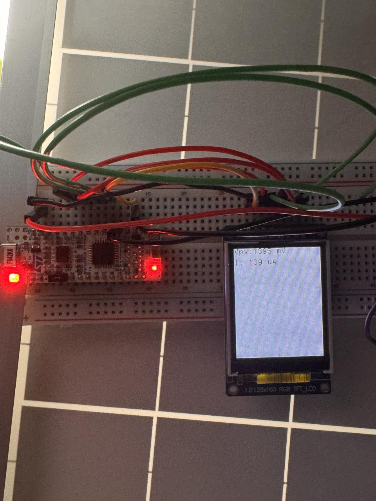

# STM32 Photovoltaic Panel Monitor

[简体中文](README.zh-CN.md) · [Minimal reproduction](#minimal-reproduction) · [Measurements](#measurements-and-limitations)

This breadboard instrument measures a loaded photovoltaic panel with an STM32F042K6T6. A resistor divider scales the panel voltage into PA0. The firmware calculates panel terminal voltage and estimates current through a fixed 10 kΩ load, then shows both values on an ST7735 SPI display.

**What worked.** The original coursework photo shows the prototype reporting approximately **1395 mV and 139 µA** on the display. The current value is calculated from the load resistance. The complete CubeIDE firmware also passed a Debug build in STM32CubeIDE 1.19.0.

## From the panel to the screen

~~~mermaid
flowchart LR
    P["PV panel under 10 kΩ load"] --> D["220 kΩ / 33 kΩ divider"]
    D --> A["PA0, 12-bit ADC"]
    A --> M["Voltage reconstruction and load-current estimate"]
    M --> T["ST7735 display"]
~~~

## Minimal reproduction

| Item | Configuration |
| --- | --- |
| Recorded hardware | STM32F042K6T6 board, breadboard, ST7735 SPI display, 220 kΩ / 33 kΩ divider and 10 kΩ load. The photo is from the breadboard revision. |
| Build tools | STM32CubeIDE 1.19.0 and STM32Cube FW_F0 V1.11.5. HAL and CMSIS sources ship with the project. |
| Reproducible build baseline | [017d0ca](https://github.com/YohtHill/pv-panel-monitor/tree/017d0ca9902bce3ca9ed7d215af6fe0c37c75150) rebuilt on Windows with CubeIDE as `lab5_4 / Debug`. It produced an ELF with zero build errors or warnings. |

1. **Wire the circuit.** Connect 220 kΩ from panel positive to the divider midpoint and 33 kΩ from the midpoint to ground. Put the 10 kΩ load across the panel and connect the midpoint to PA0. Connect ST7735 SCK/MOSI to PA5/PA7 and CS/DC/RST/BL to PA4/PA3/PA6/PA1. Share ground and check the divider midpoint with a multimeter before connecting PA0. [Wiring and conversion](docs/measurement.md)
2. **Build.** In CubeIDE use **File → Import → Existing Projects into Workspace**, choose [firmware/](firmware/), select `lab5_4` and build **Debug**. Review [lab5_4.ioc](firmware/lab5_4.ioc) for pin assignments.
3. **Flash.** Connect the board's ST-LINK or an external ST-LINK. Under **Run → Debug Configurations → STM32 C/C++ Application**, select `lab5_4` and download the Debug ELF, then run or reset the board.
4. **Check the minimum output.** Keep the 10 kΩ load, apply a known DC input checked with a multimeter, and stay within the ADC range at the divider midpoint. The screen displays `Vpv` (mV) and `I` (µA). Vary the reference and check that the voltage tracks and the current estimate follows `Vpv / 10 kΩ`. [Bench record and calibration sheet](docs/validation.md)

## Measurements and limitations

| Metric | Evidence |
| --- | --- |
| Loaded voltage and current | The archived display shows 1395 mV and an estimated 139 µA under a 10 kΩ load. |
| ADC accuracy | Firmware selects 12 bits and assumes a nominal 3.3 V reference. System error and repeatability still need calibration. |
| Sampling and display | One ADC conversion each loop and `HAL_Delay(300)` after the SPI screen update. Conversion and drawing also contribute to the sample period. Readings are displayed locally. |

[firmware/](firmware/) contains the buildable source. [docs/](docs/) includes the photo, wiring and measurement references. An I–V curve or maximum-power-point estimate requires a separate load sweep.
