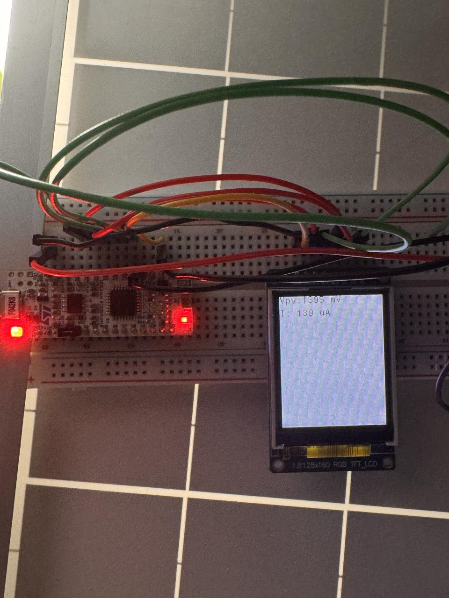

# STM32 光伏板参数监测仪

[English](README.md) · [最小复现](#最小复现) · [指标与限制](#指标与限制)

这套面包板仪器用 STM32F042K6T6 测量接入固定负载的光伏板。电阻分压后由 PA0 采样，固件反算光伏板端电压，并按 10 kΩ 负载估算电流，最后在 ST7735 彩屏显示两个读数。

**实际效果。** 课程报告的原始实物图显示，原型测得约 **1395 mV**，按负载阻值计算的电流为 **139 µA**。完整固件已在 STM32CubeIDE 1.19.0 通过 Debug 构建。

## 从光伏板到读数

~~~mermaid
flowchart LR
    P["光伏板接 10 kΩ 负载"] --> D["220 kΩ / 33 kΩ 电阻分压"]
    D --> A["PA0 的 12 位 ADC"]
    A --> M["反算端电压与负载电流"]
    M --> T["ST7735 彩屏"]
~~~

## 最小复现

| 项目 | 配置 |
| --- | --- |
| 已记录硬件 | STM32F042K6T6 开发板、面包板、ST7735 SPI 彩屏、220 kΩ/33 kΩ 分压及 10 kΩ 负载。报告照片对应面包板原型。 |
| 构建环境 | STM32CubeIDE 1.19.0、STM32Cube FW_F0 V1.11.5。HAL/CMSIS 随工程提供。 |
| 已构建源码 | [017d0ca](https://github.com/YohtHill/pv-panel-monitor/tree/017d0ca9902bce3ca9ed7d215af6fe0c37c75150) 在 Windows 下用 CubeIDE 重新构建 `lab5_4 / Debug`，生成 ELF，0 错误、0 警告。 |

1. **接线。** 光伏板正极经 220 kΩ 接分压中点，中点经 33 kΩ 接地并接到 PA0。10 kΩ 负载跨接光伏板两端。ST7735 的 SCK/MOSI 接 PA5/PA7，CS/DC/RST/BL 接 PA4/PA3/PA6/PA1。所有模块共地。接入 PA0 前先用万用表确认分压中点电压在 ADC 输入范围内。[接线与换算](docs/measurement.zh-CN.md)
2. **构建。** 在 CubeIDE 选择 **File → Import → Existing Projects into Workspace**，导入 [firmware/](firmware/)，选择工程 `lab5_4` 并构建 **Debug**。CubeMX 引脚配置可在 [lab5_4.ioc](firmware/lab5_4.ioc) 中核对。
3. **烧录。** 通过板载或外置 ST-LINK 连接 STM32。在 CubeIDE 的 **Run → Debug Configurations** 选择 **STM32 C/C++ Application**，选中 `lab5_4` 后下载 Debug ELF，随后运行或复位。
4. **最小验证。** 保持 10 kΩ 负载，使用已用万用表核对、且分压后符合 ADC 输入范围的直流参考输入。屏幕显示 `Vpv`（mV）和 `I`（µA）。调节参考输入，核对电压跟随变化，估算电流随 `Vpv / 10 kΩ` 变化。[台架记录及标定表](docs/validation.zh-CN.md)

## 指标与限制

| 项目 | 读数或状态 |
| --- | --- |
| 带载电压和电流 | 原始画面显示 1395 mV 和估算 139 µA。该电流由固定 10 kΩ 负载计算。 |
| ADC 精度 | 固件配置为 12 位、标称参考 3.3 V。系统误差与测量重复性尚未标定。 |
| 采样与显示 | 每轮一次 ADC 转换，屏幕刷新后调用 `HAL_Delay(300)`。实际采样间隔还要加上转换与绘制耗时。本版本通过本地 SPI 显示读数。 |

[firmware/](firmware/) 是可导入工程，[docs/](docs/) 存放原型照片、接线和测量说明。光伏板 I–V 曲线或最大功率点需要用多组负载另外测量。
